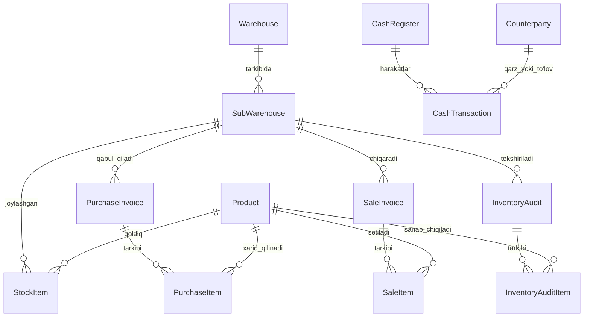

# Ichimliklar Do'koni Uchun Mini-ERP — Texnik Hujjat va Arxitektura (TECH_SPEC)

## 1. Loyihaning Maqsadi va Umumiy Ko'rinishi

Ushbu tizim ichimliklar savdosi (ulgurji va chakana) bilan shug'ullanuvchi korxonalar uchun mo'ljallangan ixtisoslashtirilgan Mini-ERP tizimidir. Tizim do'kon egasiga ombordagi tovarlar qoldig'ini, ularning joylashuvini, kassa pul aylanmasini hamda eng muhimi — biznesning **haqiqiy sof foydasini (P&L)** to'g'ri hisoblab berishni ta'minlaydi.

---

## 2. Biznes Talablari va Muammolarning Yechimlari

### 2.1. Muammo 1: Ombordagi qoldiqning noaniqligi (Dona va Blok muammosi)
- **Tushuntirish:** Ichimliklar yetkazib beruvchilardan odatda blokda (upakovka) xarid qilinadi, lekin mijozlarga ham bloklab, ham donalab sotilishi mumkin.
- **Yechim:** Har bir mahsulot kartochkasida `pcsPerPack` (blokdagi dona soni) belgilanadi.
  - Tizim qoldiqni bazada doimo **dona (baza birligi)** ko'rinishida saqlaydi (aniqlik va butunlik uchun).
  - Interfeysda esa foydalanuvchiga doimo 2 xil ko'rinishda taqdim etiladi:
    - **Umumiy dona:** Masalan, `125 dona`
    - **Blok + qoldiq dona:** `10 blok va 5 dona` (agar 1 blok = 12 dona bo'lsa: `Math.floor(125 / 12) = 10` blok, `125 % 12 = 5` dona).
  - Savdo va Xarid hujjatlarida tovar kiritayotganda xodim xohlasa "blok" miqdorini, xohlasa "dona" miqdorini kiritishi mumkin; tizim avtomatik konvertatsiya qiladi.

### 2.2. Muammo 2: Mahsulot joylashuvining noaniqligi
- **Tushuntirish:** Tovarlar turli xonalarda, sovutgichlarda yoki filiallarda turadi.
- **Yechim:** 2 bosqichli ombor tuzilmasi:
  - **Ombor (Warehouse):** Asosiy bino yoki manzil (masalan, "Markaziy Ombor", "Shahar Do'koni").
  - **Sub-ombor (Sub-Warehouse / Joylashuv):** Aniq joylashuv nuqtasi (masalan, "Sovutgich-1", "Vitrina zali", "A-seksiya 3-raf").
  - Mahsulot qoldig'i har bir sub-ombor kesimida alohida hisoblanadi. Foydalanuvchi bir qarashda "Coca-Cola 0.5L qaysi sovutgichda nechta blok bor?" degan savolga darhol javob oladi.

### 2.3. Muammo 3: Sof foydaning noaniqligi (P&L va Kassa)
- **Tushuntirish:** Do'kon egasi ko'pincha "Kassadagi pul ko'paydi = foyda qildim" yoki "Kassadan pul kamaydi = zarar qildim" deb adashadi. Chunki kassadan qarz berish, qarz olish yoki tovar xaridi sof foyda hisoblanmaydi.
- **Yechim:** Moliyaviy oqimlarni qat'iy 2 ga ajratish:
  1. **P&L (Foyda va Zarar hisoboti - Accrual Accounting):**
     - **Daromad (Revenue):** Sotilgan tovarlarning umumiy summasi.
     - **Tannarx (COGS - Cost of Goods Sold):** Sotilgan aynan o'sha tovarlarning xarid tannarxi.
     - **Yalpi foyda (Gross Profit):** `Daromad - Tannarx`.
     - **Operatsion Xarajatlar (OPEX):** Yo'l kira/transport, ijara, elektr, xodimlar oyligi, ovqatlanish va boshqa mayda xarajatlar.
     - **Inventarizatsiya natijalari:** Kamomad (zarar) yoki Ortiqcha chiqish (daromad).
     - **Sof Foyda (Net Profit):** `Yalpi Foyda - Xarajatlar - Kamomad + Ortiqchalik`.
  2. **Kassa Oqimi (Cash Flow):**
     - Qarz berish (kassadan chiqim, lekin P&L xarajati emas, balki debitorlik aktivi).
     - Qarz olish (kassaga kirim, lekin daromad emas, balki majburiyat/passiv).
     - Qarzning qaytarilishi.

---

## 3. Tizim Funksiyalari (Functional Modules)

### 3.1. Mahsulotlar boshqaruvi
- Mahsulot qo'shish/tahrirlash/o'chirish.
- Maydonlar: Nomi, Kategoriya, Shtrix-kod, 1 blokdagi donalar soni (`pcsPerPack`), Baza xarid narxi, Blok sotish narxi, Dona sotish narxi, Minimal qoldiq chegarasi.

### 3.2. Ombor va Sub-omborlar
- Ombor yaratish (Nomi, Manzili, Izoh).
- Ombor ichida Sub-omborlar yaratish (Nomi, Masalan: "1-sovutgich", "Ichki ombor", "Kassa orqasi").
- Omborlararo tovar ko'chirish (Transfer: bir sub-ombordan boshqasiga o'tkazish).

### 3.3. Xaridlar (Kirim)
- 2 bosqichli tizim:
  - `Qoralama (Draft)`: Hujjat to'ldiriladi, lekin omborga tovar kirmaydi.
  - `Bajarildi (Completed)`: Tovar qabul qilingan deb belgilanadi -> Qoldiq ko'payadi, Tannarx yangilanadi, Kassadan pul chiqadi yoki Yetkazib beruvchiga qarz yoziladi.

### 3.4. Savdolar (Sotish / Chiqim)
- 2 bosqichli tizim:
  - `Qoralama (Draft)`: Savdo tuziladi.
  - `Bajarildi (Completed)`: Tovar ombordan chiqadi -> Kassaga pul kiradi yoki Nasiya/Qarz yoziladi. Savdo paytida har bir mahsulotning o'sha paytdagi tannarxi saqlanadi (tarixiy COGS aniqligi uchun).

### 3.5. Inventarizatsiya
- Tanlangan ombor/sub-ombor bo'yicha inventarizatsiya hujjati ochiladi.
- Tizimdagi kutilayotgan qoldiq ko'rsatiladi.
- Xodim haqiqiy sanalgan dona va blok miqdorini kiritadi.
- Hujjat tasdiqlanganda tizim qoldiqni haqiqiy songa to'g'rilaydi va o'rtadagi farqni "Kamomad (Zarar)" yoki "Ortiqcha (Daromad)" sifatida P&L hisobotiga uzatadi.

### 3.6. Kassa va Xarajatlar (Kirim/Chiqim)
- Kassa balansi (Naqd, Karta).
- Kirim operatsiyalari: Boshqa kirimlar, Olingan qarz, Mijozdan qarz undirish.
- Chiqim operatsiyalari:
  - Yo'l kira / Logistika
  - Do'kon ijarasi
  - Xodimlar maoshi
  - Kommunal to'lovlar
  - Boshqa xarajatlar
  - Qarz berish (uchinchi shaxsga)
  - Olingan qarzni qaytarish

### 3.7. Hisobotlar va Analitika
1. **Ombor Qoldiqlari:**
   - Mahsulot bo'yicha umumiy va har bir sub-omborda qancha (dona va blokda).
   - Umumiy ombor qiymati (tannarxda va sotish narxida).
2. **Savdo Hisoboti:**
   - Vaqt oralig'i bo'yicha savdo hajmi, sotilgan tovarlar, o'rtacha chek.
3. **P&L (Foyda va Zarar) Hisoboti:**
   - Tanlangan davr (kun, oy, yil yoki ixtiyoriy sana oralig'i) uchun sof foyda hisobi.

---

## 4. Tanlangan Texnologik Stek (Tech Stack)

Foydalanuvchi talabiga ko'ra loyihaning arxitekturasi quyidagicha belgilandi:

| Qatlam | Texnologiya | Tavsifi va Vazifasi |
| :--- | :--- | :--- |
| **Frontend** | **Next.js (TypeScript, App Router)** | Zamonaviy va qulay foydalanuvchi interfeysi, tezkor yuklanish. |
| **Dizayn & UI** | **Tailwind CSS + Shadcn UI + Lucide Icons** | Chiroyli, toza, zamonaviy va qulay ERP boshqaruv paneli (Dona/Blok maxsus indikatorlari, zamonaviy jadval va dialoglar). |
| **Backend** | **NestJS (TypeScript)** | Kengaytiriluvchi modulli arxitektura (Controllers, Services, DTOs, Business Logic). |
| **ORM** | **Prisma ORM** | PostgreSQL bilan xavfsiz va qulay ishlash, migratsiyalar, ACID tranzaksiyalar boshqaruvi. |
| **Ma'lumotlar bazasi** | **PostgreSQL** | Kuchli relatsion baza, murakkab moliyaviy hisobotlar va tranzaksiyalar uchun to'liq mos. |

---

## 5. Loyiha Tuzilmasi (Monorepo)

```text
market-erp/
├── backend/                   # NestJS API (Port: 4000)
│   ├── src/
│   │   ├── prisma/            # Prisma schema, migrations va service
│   │   ├── modules/
│   │   │   ├── products/      # Mahsulotlar moduli
│   │   │   ├── warehouses/    # Ombor va Sub-omborlar moduli
│   │   │   ├── purchases/     # Xaridlar (Kirim) moduli
│   │   │   ├── sales/         # Savdolar (Chiqim) moduli
│   │   │   ├── inventory/     # Inventarizatsiya moduli
│   │   │   ├── cashbox/       # Kassa va Qarzlar moduli
│   │   │   └── reports/       # Qoldiqlar, Savdo va P&L hisoboti
│   │   ├── main.ts
│   │   └── app.module.ts
│   └── package.json
│
├── frontend/                  # Next.js UI (Port: 3000)
│   ├── src/
│   │   ├── app/               # App Router sahifalari
│   │   ├── components/        # Shadcn UI va umumiy komponentlar
│   │   ├── lib/               # API mijoz, Dona/Blok kalkulyator utilitlari
│   │   └── types/             # TypeScript interfeyslari
│   └── package.json
│
├── PROMPTS.md                 # Foydalanuvchi AI promptlari jurnali
├── USER_GUIDE.md              # Foydalanuvchi qo'llanmasi
└── TECH_SPEC.md               # Ushbu texnik hujjat
```

---

## 5. Ma'lumotlar Bazasi Modeli (ERD)



---

## 6. Ishlab Chiqish Bosqichlari (Roadmap)

1. **1-Bosqich:** Hujjatlar va Arxitekturani tasdiqlash (Hozirgi bosqich).
2. **2-Bosqich:** Loyiha bazasini yaratish (Next.js, Tailwind CSS, Prisma ORM, SQLite).
3. **3-Bosqich:** Ma'lumotlar bazasi sxemasini yozish va boshlang'ich test ma'lumotlarini (Seed: ichimliklar, omborlar, kassa) kiritish.
4. **4-Bosqich:** Mahsulotlar va Ombor/Sub-omborlar boshqaruvi moduli (Dona va Blok hisob-kitob utilitlari bilan).
5. **5-Bosqich:** Xaridlar (Purchase) moduli (Qoralama -> Bajarildi -> Omborga kirim).
6. **6-Bosqich:** Savdolar (Sales) moduli (Qoralama -> Bajarildi -> Ombordan chiqim + Kassa kirimi).
7. **7-Bosqich:** Inventarizatsiya moduli (Taqqoslash, kamomad/ortiqchalikni avtomatik to'g'rilash).
8. **8-Bosqich:** Kassa va Xarajatlar moduli (Yo'l kira, ijara, qarz berish/olish).
9. **9-Bosqich:** Hisobotlar moduli (Qoldiqlar ro'yxati, Savdolar tahlili, P&L Sof Foyda kalkulyatsiyasi).
10. **10-Bosqich:** Sinov, testlar o'tkazish, `PROMPTS.md` va `USER_GUIDE.md` hujjatlarini yakunlash.

